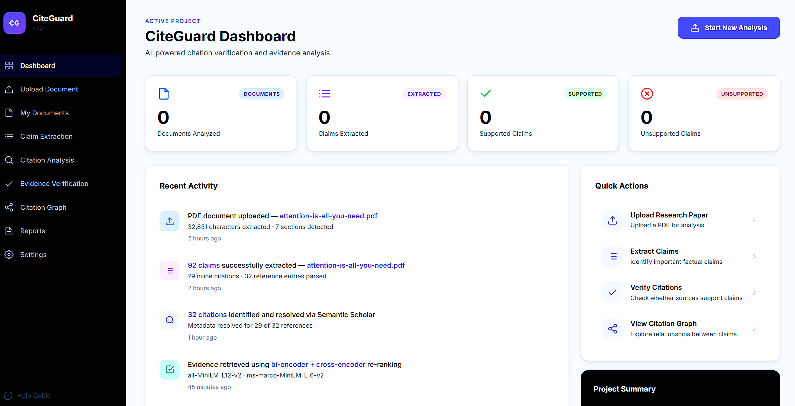
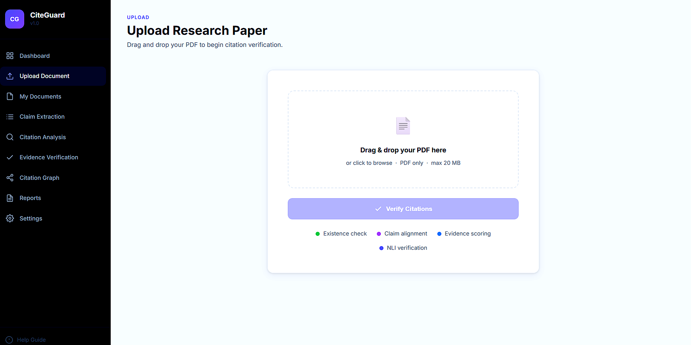
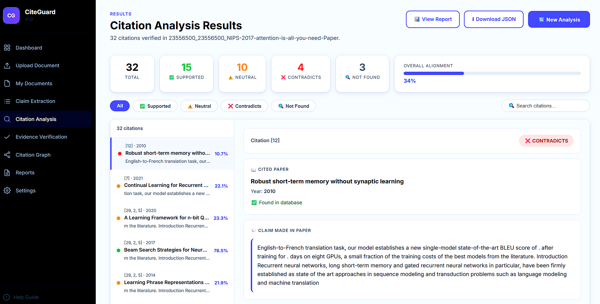
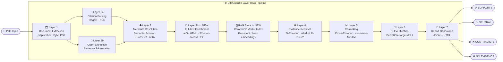
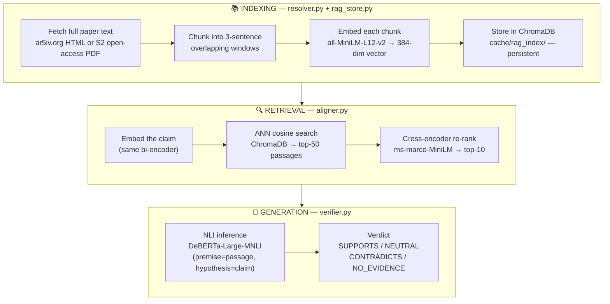

# CiteGuard 🔍

> **AI-Powered Citation Verification & Evidence Analysis for Research Papers — with RAG Pipeline**


CiteGuard automatically checks every citation in a research paper to verify:
1. **Existence** – does the cited paper actually exist?
2. **Alignment** – does it actually support the claim being made?
3. **Verdict** – Supports / Neutral / Contradicts / No Evidence

---

## Screenshots

### 🏠 Dashboard


### 📤 Upload Document


### 📊 Citation Analysis Results


---

## Architecture Diagram



---

## RAG Pipeline (Retrieval-Augmented Generation)

CiteGuard uses a full **3-phase RAG architecture** to verify citations against evidence:



### RAG vs Previous (abstract-only)

| | Before | After (RAG) |
|---|---|---|
| Evidence corpus | Abstract only (~200 words) | Full paper body (~8,000–15,000 words) |
| Chunks per paper | 3–5 | 400–800 |
| Vector store | In-memory (re-computed every run) | ChromaDB (persistent, index once) |
| Speed (2nd run) | Slow (re-embeds) | Fast (query only) |

---

## Pipeline Overview

| Layer | Name | Tools / Models |
|---|---|---|
| **1** | Document Extraction | `pdfplumber`, `PyMuPDF` |
| **2a** | Citation Parsing | Regex + spaCy NER |
| **2b** | Claim Extraction | Sentence tokenisation |
| **3** | Metadata Resolution | Semantic Scholar API, CrossRef, arXiv |
| **3b** ✨ | Full-text Enrichment | ar5iv.org HTML, S2 open-access PDF |
| **RAG** ✨ | Vector Store | ChromaDB (persistent, `cache/rag_index/`) |
| **4** | Evidence Retrieval | Bi-encoder (`all-MiniLM-L12-v2`) |
| **5** | Re-ranking | Cross-encoder (`ms-marco-MiniLM-L-6-v2`) |
| **6** | NLI Verification | DeBERTa-Large-MNLI |
| **7** | Report Generation | Jinja2 → JSON + HTML |

---

## Verdict Labels

| Label | Meaning |
|---|---|
| ✅ **SUPPORTS** | Cited paper's content entails the claim |
| ⚠️ **NEUTRAL** | Weak or tangential relationship |
| ❌ **CONTRADICTS** | Cited paper's content contradicts the claim |
| 🔍 **NO_EVIDENCE** | Paper not found or abstract unavailable |

---

## Quick Start

```bash
# 1. Clone the repository
git clone https://github.com/JAGADISH-JSK/CiteGuard-Citation-Verification.git
cd CiteGuard-Citation-Verification

# 2. Create virtual environment
python -m venv .venv
.venv\Scripts\activate        # Windows
# source .venv/bin/activate   # macOS/Linux

# 3. Install dependencies
pip install -r requirements.txt

# 4. Configure environment
copy .env.example .env
# (edit .env if you have a Semantic Scholar API key)

# 5a. Run on a paper (CLI)
python main.py input/your_paper.pdf

# 5b. Run the web dashboard
uvicorn api:app --reload --port 8000
# Open http://127.0.0.1:8000
```

---

## Project Structure

```
citeguard/
├── modules/
│   ├── extractor.py         # Layer 1  – PDF parsing
│   ├── citation_parser.py   # Layer 2a – citation detection
│   ├── claim_extractor.py   # Layer 2b – claim sentence extraction
│   ├── resolver.py          # Layer 3  – API metadata lookup + full-text fetch ✨
│   ├── rag_store.py         # RAG Store – ChromaDB vector index ✨ NEW
│   ├── aligner.py           # Layers 4+5 – bi-encoder + cross-encoder (RAG-upgraded) ✨
│   ├── verifier.py          # Layer 6  – NLI fact verification
│   └── reporter.py          # Layer 7  – report generation
├── static/
│   ├── index.html           # Dashboard UI
│   ├── style.css            # Styles
│   └── app.js               # Frontend logic
├── docs/
│   └── screenshots/         # Project screenshots
├── input/                   # Drop your PDFs here
├── output/                  # Reports written here
├── cache/
│   ├── *.json               # API response cache
│   └── rag_index/           # ChromaDB persistent vector store ✨ NEW
├── tests/                   # Unit tests
├── config.py                # Central configuration
├── main.py                  # CLI pipeline entry point
├── api.py                   # FastAPI web server
├── requirements.txt
└── .env.example
```

---

## Configuration

All settings can be overridden via environment variables (see `.env.example`):

| Variable | Default | Description |
|---|---|---|
| `EMBEDDING_MODEL` | `all-MiniLM-L12-v2` | Bi-encoder model |
| `NLI_MODEL` | `cross-encoder/nli-deberta-v3-large` | NLI model |
| `TOP_K_RETRIEVAL` | `50` | Bi-encoder candidate count |
| `TOP_K_RERANK` | `10` | Cross-encoder output count |
| `NLI_THRESHOLD` | `0.5` | Minimum confidence to assign verdict |
| `RAG_FULL_TEXT` | `true` | Fetch full paper text (set `false` for abstract-only mode) ✨ |
| `RAG_MAX_CHARS` | `120000` | Max characters of full text fed to chunker ✨ |
| `S2_API_KEY` | _(empty)_ | Semantic Scholar API key |
| `LOG_LEVEL` | `INFO` | Logging verbosity |

---

## Tech Stack

| Component | Technology |
|---|---|
| Backend | Python · FastAPI · Uvicorn |
| PDF Parsing | pdfplumber · PyMuPDF |
| NLP | sentence-transformers |
| NLI Model | DeBERTa-Large-MNLI (HuggingFace) |
| **RAG Vector Store** | **ChromaDB (persistent)** ✨ |
| **Full-text Source** | **ar5iv.org · S2 open-access PDF** ✨ |
| Metadata APIs | Semantic Scholar · CrossRef · arXiv |
| Frontend | HTML · CSS · Vanilla JS |
| Report | Jinja2 · JSON · HTML |

---

## IBM Watson / Granite Integration

To use IBM's embedding models, update `EMBEDDING_MODEL` in `.env`:

```env
EMBEDDING_MODEL=ibm-granite/granite-embedding-278m-multilingual
```

For full IBM watsonx integration, replace the sentence-transformers calls
in `modules/aligner.py` with the watsonx.ai embeddings API.

---

## License

MIT License — free to use, modify and distribute.
